# ⚡ POWER FITNESS — Enterprise Gym Management System

[](https://dotnet.microsoft.com/)
[](https://learn.microsoft.com/aspnet/core)
[](https://learn.microsoft.com/ef/core)
[](https://icons.getbootstrap.com/)
[](docs/screenshots/)

An enterprise-grade, athletic-luxury Gym Management System built with **ASP.NET Core MVC**, **Entity Framework Core**, and **SQL Server**. Engineered with a clean N-Tier architecture (DAL, BLL, PL), automated capacity controls, biometric baseline health integration, role-based security, and a high-contrast dark luxury user interface.

---

## 📸 Application Showcase

### 1. Landing Page — "Built for the Relentless"
High-impact dark luxury aesthetic featuring real-time athlete KPI counters, an elite coach showcase, and rapid session access.

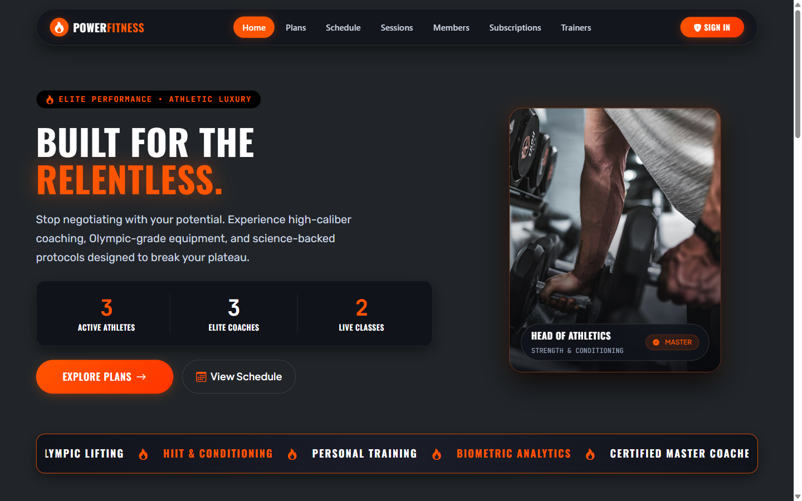

### 2. Athletic Disciplines & Coached Workouts
Dynamic 16:9 aspect-ratio workout cards with bottom gradient vignettes covering Functional Strength, Cardio & HIIT Burn, and Hypertrophy training.

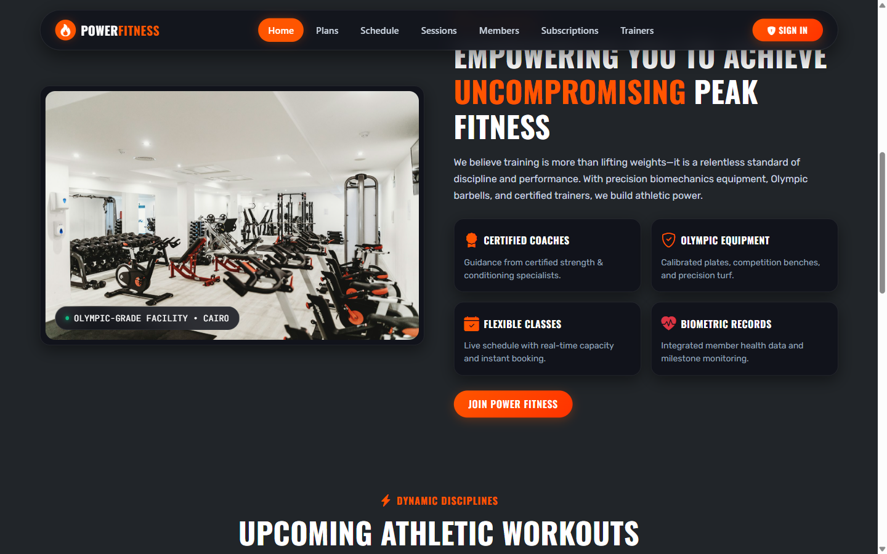

### 3. Modern Facility & The Power Advantage
Showcase of Olympic-standard lifting facilities, calibrated barbells, and biometric tracking amenities.

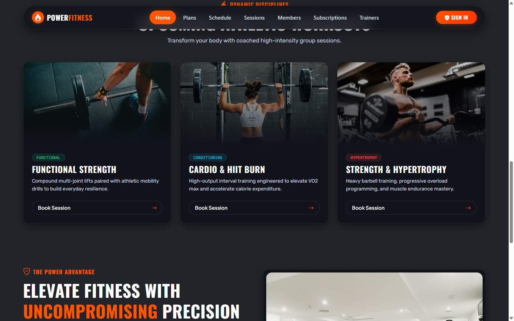

---

## 🏛️ System Architecture

The solution adheres to clean architecture principles separated across 3 distinct tiers:

```
GymManagementSystemSol/
├── GymManagementSystem.DAL/          # Data Access Layer
│   ├── Context/                      # ApplicationDbContext & IdentityDbContext
│   ├── Data/Seeder/                  # DatabaseSeeder & GymDemoDataSeeder
│   ├── Entities/                     # Member, Trainer, Session, Plan, Membership, Booking, HealthRecord
│   └── Repositories/                 # Generic Repository & UnitOfWork Implementation
│
├── GymManagementSystem.BLL/          # Business Logic Layer
│   ├── Services/                     # MemberService, TrainerService, SessionService, PlanService, etc.
│   ├── ViewModels/                   # Strongly typed DTOs and Presentation Models
│   └── Mapping/                      # AutoMapper Profiles
│
└── GymManagementSystem/              # Presentation Layer (PL - ASP.NET Core MVC)
    ├── Controllers/                  # HomeController, MemberController, TrainerController, SessionController...
    ├── Views/                        # Razor Views themed with Custom Dark Luxury System
    └── wwwroot/                      # CSS Tokens, Bootstrap Icons, Cleaned Image Assets
```

### Architectural Highlights
- **Repository & Unit of Work Patterns**: Centralizes data access, minimizes database roundtrips, and ensures atomic business transactions.
- **Strict Separation of Concerns**: Controllers only communicate with BLL Service interfaces; database entities never leak into presentation views.
- **Strong Typing & AutoMapper**: Automatic mapping between database domain models and view-specific ViewModels.
- **Custom Design Token Engine**: Proprietary CSS variable foundation (`design-tokens.css` & `power-theme.css`) delivering consistent contrast ratios, glowing neon accents (`#FF5500`), and dark obsidian glass cards.

---

## 🌟 Key Modules & Screenshots

### 🔐 1. Authentication & Security Portal
* ASP.NET Core Identity with role-based authorization (`Admin`, `Trainer`).
* Pre-configured **1-Click Auto-Fill** credentials for rapid administrative or trainer evaluation.
* Tamper-proof Anti-Forgery token validation across all mutable POST endpoints.

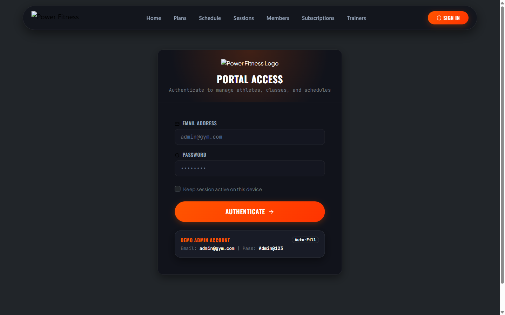

---

### 🏃 2. Athlete Management & Biometric Records
* **Athlete Directory (`/Member`)**: High-contrast directory with status indicators, contact details, and color-coded action buttons.
* **Athlete Profile (`/Member/Details/{id}`)**: Complete profile card with active membership badges and package tenure.
* **Biometric & Health Integration (`/Member/HealthRecordDetails/{id}`)**: Records baseline height, weight, BMI metrics, blood group, and cardiac/injury medical restrictions to ensure training safety.

| Athletes Directory | Athlete Profile | Biometric Health Details |
| :---: | :---: | :---: |
| 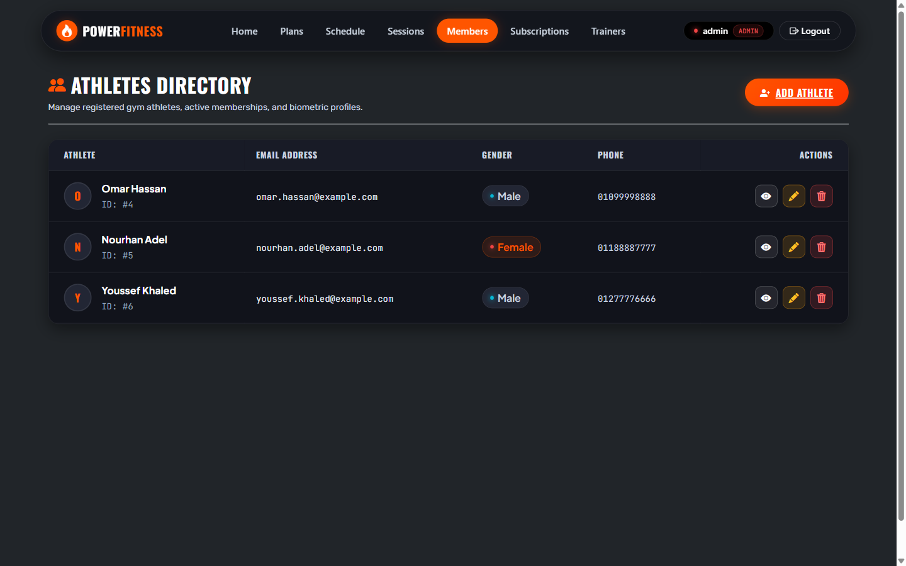 | 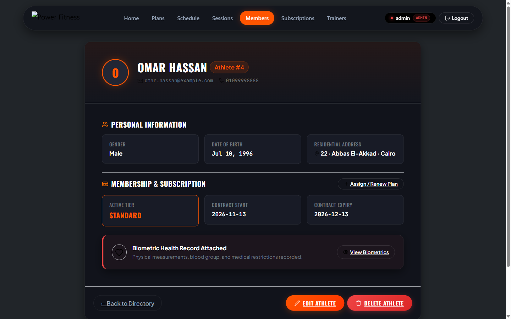 | 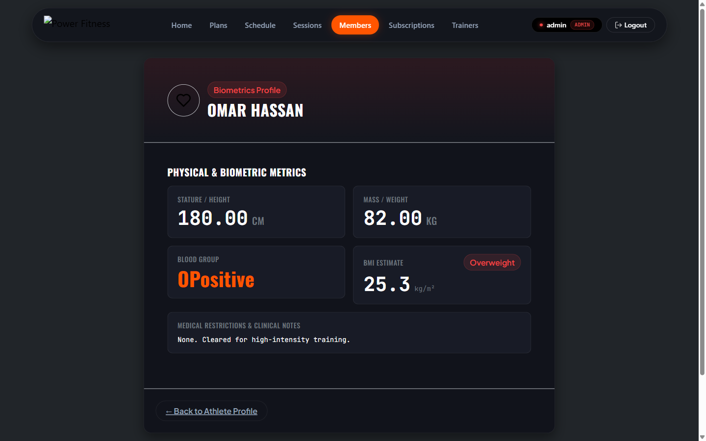 |

---

### 🏋️ 3. Coach & Trainer Management (`/Trainer`)
* Certified coach onboarding with discipline specialties: **Cardio Trainer**, **General Fitness Trainer**, and **CrossFit Trainer**.
* Referential integrity protection: Coaches assigned to upcoming sessions cannot be accidentally deleted.

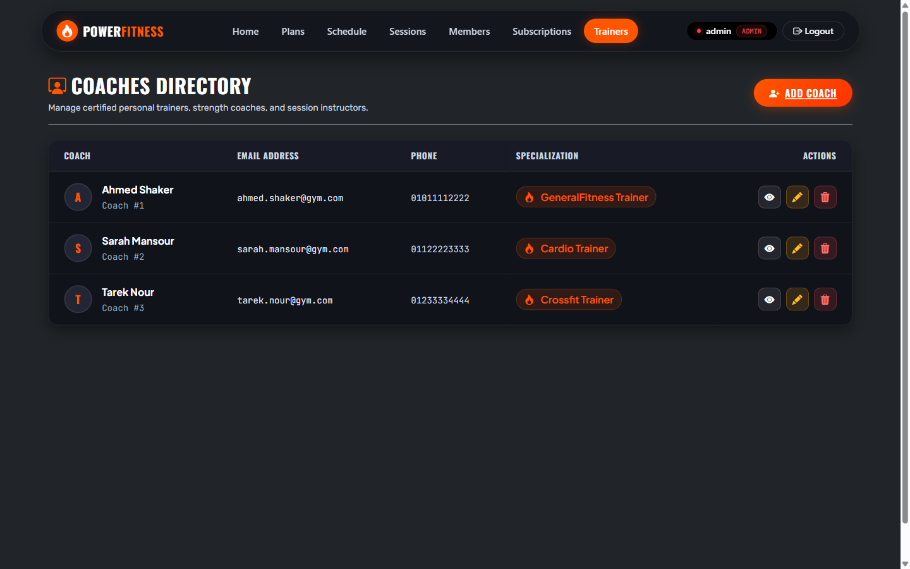

---

### 📅 4. Training Sessions & Live Attendance Rosters (`/Session`)
* **Schedule Hub (`/Session`)**: Filter workouts by discipline category, coach, and time slot.
* **Session Roster & Capacity (`/Session/Details/{id}`)**: Live capacity bar tracking booked spots versus max allowable athlete capacity. Displays the enrolled athlete roster in real time.

| Training Schedule | Session Details & Live Roster |
| :---: | :---: |
| 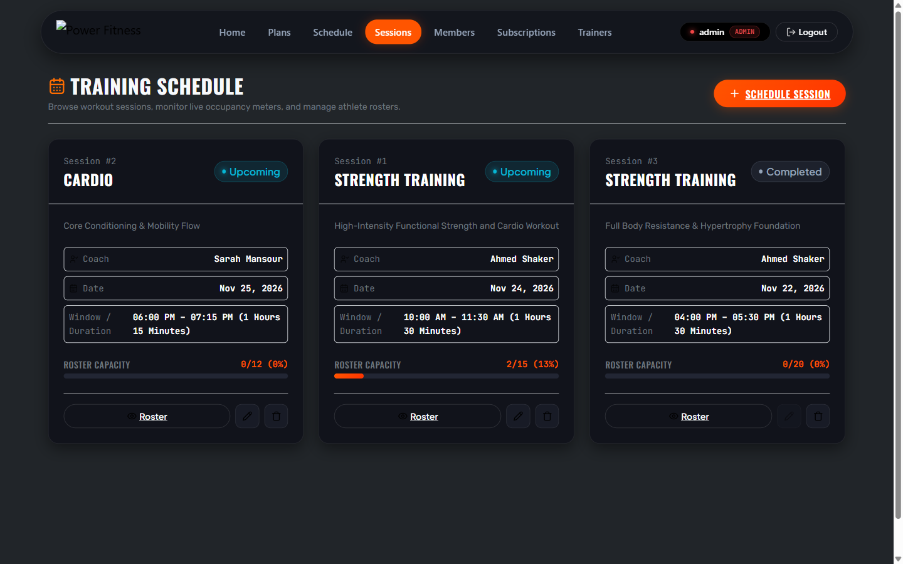 | 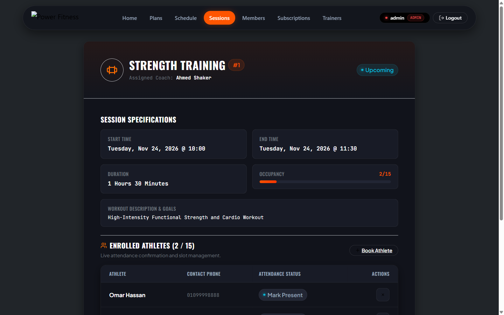 |

---

### 📝 5. Session Bookings Hub (`/Booking`)
* Allows assigning active athletes to scheduled workout sessions.
* **Automated Capacity Enforcement**: Prevents registrations once session capacity is reached.
* **Duplicate Prevention**: Rejects duplicate athlete bookings for the same workout session.

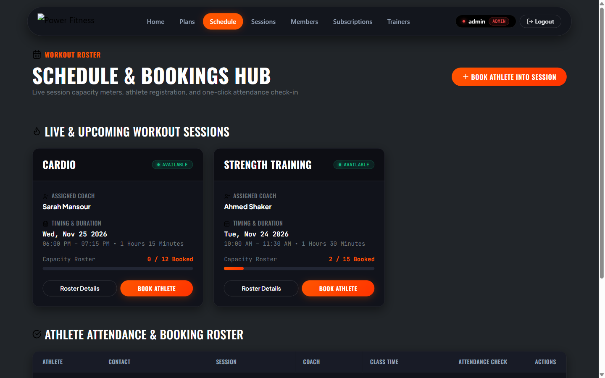

---

### 💳 6. Membership Contracts & Subscription Packages
* **Subscriptions Directory (`/MemberShip`)**: Status tabs for **All**, **Active**, **Upcoming**, and **Expired** contracts.
* **Contract Auto-Calculation**: Start dates automatically compute expiration dates according to the chosen package duration.
* **Package Management (`/Plans`)**: Admin-controlled membership tiers (Monthly, Quarterly, Semi-Annual, Annual) with protected pricing and descriptions.

| Subscriptions Directory | Membership Tiers & Plans |
| :---: | :---: |
| 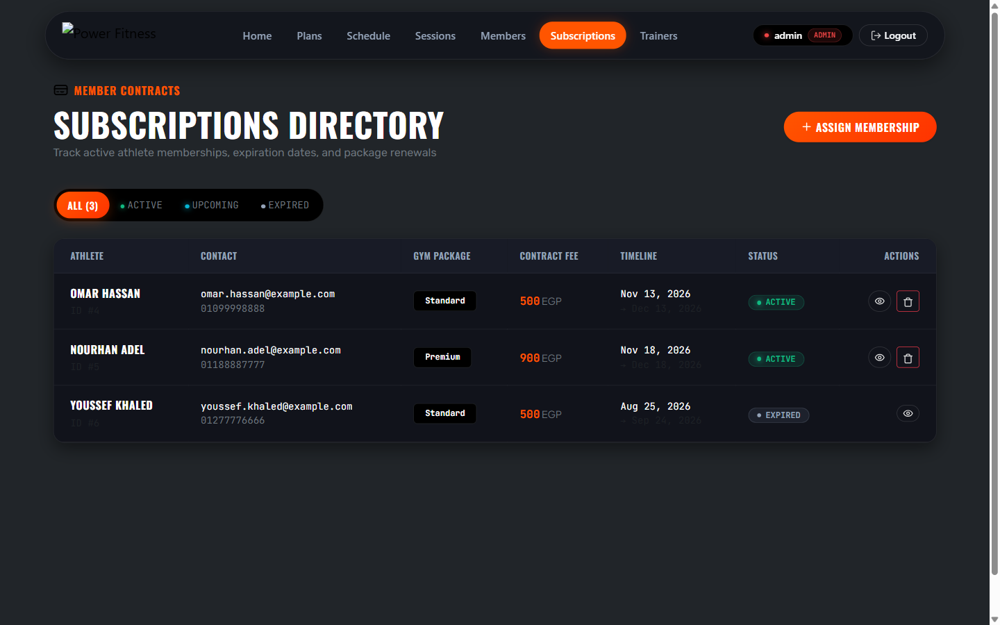 | 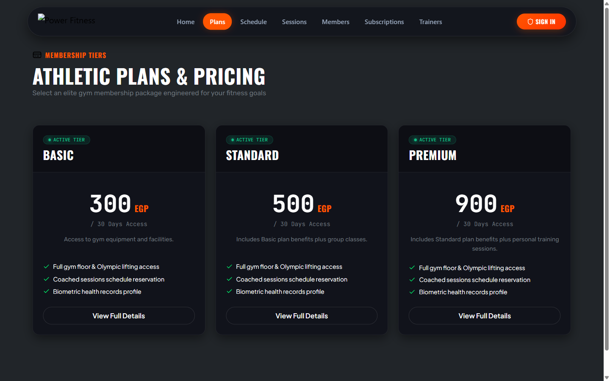 |

---

## ⚙️ Core Business Rules

| Domain | Rule | Enforcement Mechanism |
| :--- | :--- | :--- |
| **Session Booking** | Max capacity cap | Rejects booking if `BookedSlots >= Capacity` |
| **Session Booking** | Unique attendance | Rejects registration if athlete is already enrolled |
| **Membership** | Active membership prerequisite | Verifies athlete holds an active contract covering session date |
| **Membership** | Non-overlapping packages | Prevents athlete from holding overlapping active memberships |
| **Trainer Deletion** | Active schedule lock | Blocks deletion of coaches assigned to active/future sessions |
| **Plan Modification** | Contract protection | Locks plan names on existing plans to preserve contract history |

---

## 🚀 Getting Started

### Prerequisites
- [.NET 9.0 SDK](https://dotnet.microsoft.com/download) or [.NET 10.0 Preview](https://dotnet.microsoft.com/download/dotnet/10.0)
- [SQL Server](https://www.microsoft.com/sql-server/) (LocalDB, Express, or Full Instance)

### Installation & Run

1. **Clone the Repository**:
   ```bash
   git clone https://github.com/your-username/GymManagementSystemSol.git
   cd GymManagementSystemSol
   ```

2. **Configure Database Connection**:
   Update `GymManagementSystem/appsettings.json` if your SQL Server instance uses custom credentials:
   ```json
   "ConnectionStrings": {
     "DefaultConnection": "Server=(localdb)\\mssqllocaldb;Database=GymManagementSystemDb;Trusted_Connection=True;MultipleActiveResultSets=true;TrustServerCertificate=True"
   }
   ```

3. **Apply Database Migrations & Seed Data**:
   Database tables, roles, and realistic demo data (athletes, coaches, sessions, packages) will automatically seed upon first launch:
   ```bash
   dotnet build
   ```

4. **Launch the Application**:
   ```bash
   dotnet run --project GymManagementSystem
   ```
   Open your browser and navigate to: **`http://localhost:5297`**

---

## 🔑 Demo Access Credentials

The database automatically seeds with pre-configured administrative and coach accounts:

| Role | Email Address | Password | Privileges |
| :--- | :--- | :--- | :--- |
| **System Administrator** | `admin@gym.com` | `Admin@123` | Full access: CRUD plans, coaches, sessions, members, subscriptions |
| **Certified Trainer** | `trainer@gym.com` | `Trainer@123` | Operational access: View schedule, sessions, and enrolled athlete rosters |

> **Tip**: You can click the **1-Click Auto-Fill** buttons on the [Sign In page](http://localhost:5297/Account/Login) to immediately populate credentials.

---

## 🛠️ Built With

* **Backend**: C# 12, ASP.NET Core 9.0 / 10.0, Entity Framework Core 9.0, AutoMapper
* **Database**: Microsoft SQL Server / LocalDB
* **Security**: ASP.NET Core Identity, BCrypt/PBKDF2 Password Hashing, CSRF Tokens
* **Frontend**: Razor Pages / MVC, Bootstrap 5.3, Bootstrap Icons v1.11.3
* **Typography**: Bebas Neue (Headlines), Plus Jakarta Sans (Body), JetBrains Mono (Metrics & IDs)
* **Testing & Verification**: Playwright MCP, xUnit

---

## 📄 License
This project is licensed under the MIT License — see the [LICENSE](LICENSE) file for details.
